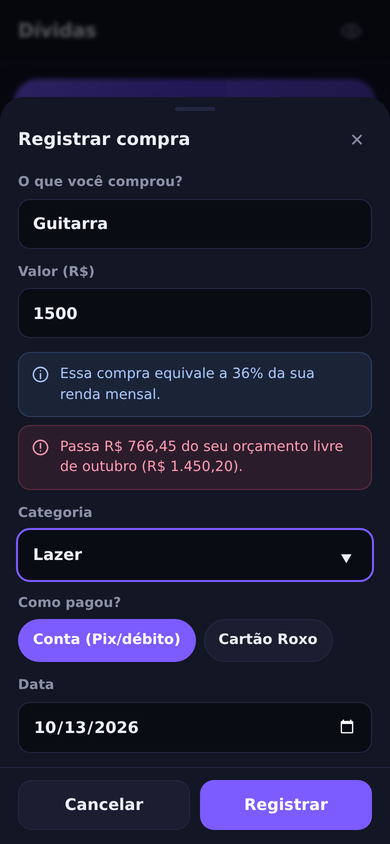
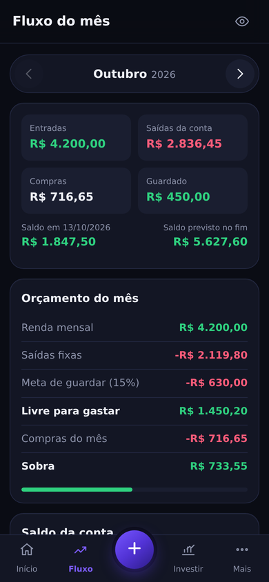
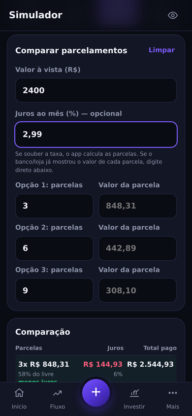
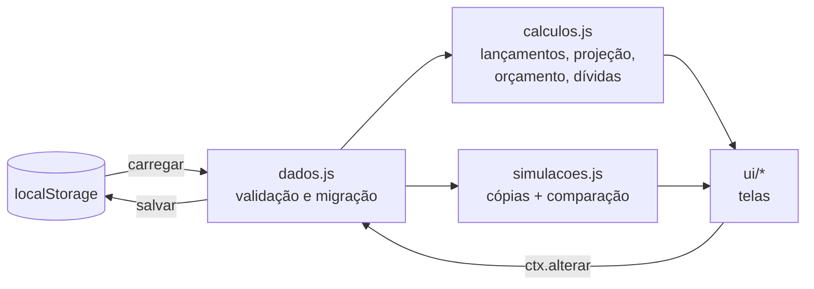

# 💰 Minhas Finanças

**Aplicativo web instalável (PWA) de controle financeiro pessoal**: registra entradas, saídas e compras, calcula quanto ainda dá para gastar no mês, projeta o saldo dia a dia, acompanha dívidas e investimentos e simula decisões antes de tomá-las.

Feito com **HTML, CSS e JavaScript puros**: sem framework, sem etapa de build, sem dependências externas. Funciona **offline** e os dados ficam **só no aparelho**.


> 🔗 **Demo:** `https://SEU-USUARIO.github.io/financas-pwa/` (abra no celular e toque em "Ver com dados de exemplo")

---

## Por que este projeto

Criei este app para resolver um problema real meu: entender **quando** o dinheiro entra e sai, e não só **quanto**. Uma fatura que vence no dia 5 e um salário que cai no último dia útil podem deixar a conta negativa por semanas, mesmo com o mês "fechando no azul". Planilhas mostram o total; este app mostra a **linha do tempo**.

Com o tempo, ele evoluiu de uma projeção de curto prazo para uma ferramenta de **consciência financeira**: orçamento mensal com meta de poupança, avisos antes de cada compra, reserva de emergência e acompanhamento até a quitação das dívidas.

## Funcionalidades

| | |
|---|---|
| **Saldo dia a dia** | Projeta o saldo da conta para os próximos meses a partir do saldo real, considerando salário (último dia útil), contas fixas, faturas e parcelas. |
| **Orçamento do mês** | `livre = renda − saídas fixas − meta de guardar`. Mostra quanto ainda dá para gastar e quanto já foi guardado. |
| **Registro de compras** | Enquanto você digita o valor, avisa o peso na renda, se cabe no orçamento e se a conta ficaria negativa. |
| **Fluxo mensal** | A "planilha" do mês: entradas, saídas, compras, gráfico do saldo e gastos por categoria. |
| **Investimentos** | Caixinhas com rendimento em % do CDI, % a.a. ou % a.m.; reserva de emergência com valor recomendado (6 × gastos fixos) e prazo estimado. |
| **Dívidas** | Quanto falta em cada cartão e parcelamento, progresso e data em que tudo termina; botão "Paguei" atualiza o saldo. |
| **Simulador** | *E se eu comprar? E se eu cortar? Qual parcelamento compensa? Quanto guardar para uma meta?* Nada é salvo. |
| **Lembretes** | Notificações de contas a vencer e exportação para o calendário do celular (`.ics`). |
| **Privacidade** | Sem servidor e sem login. Backup e restauração por arquivo JSON. Botão de "olho" esconde os valores. |

<p align="center">
  
  
  
  
</p>

## Decisões técnicas

- **Dinheiro em centavos inteiros.** Em ponto flutuante, `0.1 + 0.2 = 0.30000000000000004`. Todo valor é guardado como inteiro (R$ 12,34 → `1234`) e só é dividido por 100 na hora de exibir.
- **Datas como texto ISO (`AAAA-MM-DD`) e contas em UTC.** A comparação vira comparação de texto e não há bugs de fuso horário. Meses de 28 a 31 dias e "último dia útil" são tratados explicitamente.
- **Motor de cálculo separado da interface.** `calculos.js` e `simulacoes.js` não tocam na tela: recebem dados e devolvem números. Isso permite testá-los isoladamente.
- **Simulações sem efeito colateral.** Cada cenário roda sobre uma cópia profunda (`structuredClone`) dos dados e é comparado com o cenário real.
- **Matemática financeira.** Parcelas pela Tabela Price, `PMT = PV · i / (1 − (1 + i)^−n)`; conversão de % do CDI anual para taxa mensal composta, `(1 + CDI·p)^(1/12) − 1`; aporte mensal necessário pelo valor futuro de uma série.
- **Sem dependências.** Gráficos de linha e de rosca desenhados em SVG à mão; ícones SVG próprios. Tudo funciona offline e cabe em poucos arquivos.
- **PWA.** Service worker com cache offline, manifest, ícones *maskable* e caminhos relativos (compatível com o subcaminho do GitHub Pages).
- **Migração de dados.** `normalizar()` valida e converte arquivos de versões anteriores, então um backup antigo nunca quebra o app.
- **Segurança.** Todo texto digitado é escapado antes de ir para o HTML (prevenção de XSS).

## Arquitetura



Toda alteração passa por uma única função (`ctx.alterar`): copia os dados, aplica a mudança, salva e redesenha. É um fluxo de dados em uma direção só, simples de entender e de depurar.

```
index.html            Página única
manifest.json         Instalação (PWA)
sw.js                 Service worker: cache offline e lembretes
css/style.css         Visual mobile-first, tema escuro e claro
js/
  app.js              Estado e navegação
  dados.js            Formato, validação, migração, backup
  calculos.js         Motor: lançamentos, projeção, orçamento, investimentos, dívidas, alertas
  simulacoes.js       Cálculos do simulador
  datas.js            Datas, dias úteis, formatação dd/mm/aaaa
  dinheiro.js         Centavos ⇄ R$ 1.234,56
  grafico.js          Gráficos SVG
  notificacoes.js     Notificações e calendário .ics
  ui/                 Uma tela por arquivo + peças comuns e ícones
testes/
  calculos.test.mjs   Testes automatizados dos cálculos
docs/                 Imagens deste README (dados fictícios)
```

## Modelo de dados

Todos os dados ficam num único objeto JSON (o mesmo do backup). Resumo:

| Coleção | Campos principais |
|---|---|
| `conta` | `saldoInicial` (centavos), `dataSaldo` |
| `eventos` | entradas e saídas: `tipo`, `categoria`, `valor`, `recorrencia` (`unica`, `mensal`, `ultimoDiaUtil`), `inicio`, `fim` |
| `cartoes` | `faturas[]` (`vencimento`, `valor`, `paga`, `pagaEm`), `parcelamento` |
| `compras` | `descricao`, `valor`, `data`, `categoria`, `pagamento` (conta ou id do cartão) |
| `investimentos` | `tipo` (emergência, caixinha, variável), `saldo`, `rendimento` (`modo`, `taxa`) |
| `movimentos` | aportes e resgates: `investimentoId`, `tipo`, `valor`, `data` |
| `config` | `metaGuardarPct`, `cdiAnual`, `mesesAFrente`, lembretes |

## Testes

Os cálculos têm testes automatizados com o test runner nativo do Node (18+), sem instalar nada:

```
node --test testes/calculos.test.mjs
```

Cobrem: leitura de valores no formato brasileiro, meses de tamanhos diferentes, último dia útil, projeção do saldo, orçamento, juros compostos, contagem de parcelas, Tabela Price e a garantia de que o simulador não altera os dados.

## Rodar localmente

Módulos JavaScript não funcionam abrindo o `index.html` com duplo clique. Use um servidor local:

```
python -m http.server 8000
```

Depois acesse `http://localhost:8000`.

## Publicar e instalar

1. Suba os arquivos num repositório público e ative **Settings → Pages → Deploy from a branch → main / (root)**.
2. **Android (Chrome):** abra o link e toque em **⋮ → Instalar app**.
3. **iPhone (Safari):** **Compartilhar → Adicionar à Tela de Início**. Importe os dados *dentro* do app instalado, porque Safari e app guardam dados separadamente.

Ao publicar uma nova versão, aumente a constante `VERSAO` no `sw.js` para os celulares baixarem os arquivos novos.

## ⚠️ Privacidade

- Este repositório **não contém dados financeiros reais**. O app abre vazio ou com dados de **exemplo fictícios** (também usados nas imagens deste README).
- Os dados reais ficam no `localStorage` do aparelho e são importados por arquivo JSON mantido **fora** do repositório.
- O `.gitignore` bloqueia arquivos de dados, backups e calendários (`dados-*.json`, `financas-backup-*.json`, `*.ics`).

## Aviso

Projeções e rendimentos são **estimativas** baseadas nos números informados pelo usuário (rendimentos antes de impostos). Este app é uma ferramenta de organização, não consultoria financeira.

## Próximos passos

- Exportar o histórico de lançamentos em CSV para análise em Python/pandas ou SQL.
- Painel de tendências: gastos por categoria ao longo dos meses.
- Importar extratos bancários (OFX/CSV).

---

Desenvolvido por **João Santos Fonseca** · [LinkedIn](https://www.linkedin.com/in/SEU-PERFIL) · Licença [MIT](LICENSE)
